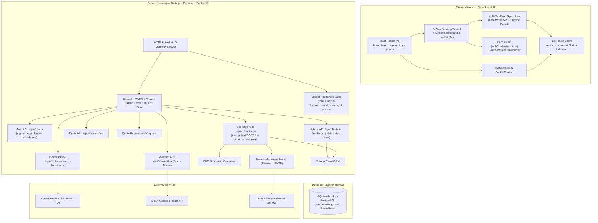

# 🌍 Travel Trip — Full-Stack Real-Time Trip Booking Platform

A production-grade, real-time travel booking application built as a modern monorepo. Upgraded from a 5-step React booking wizard into an end-to-end full-stack platform featuring an Express REST API, Socket.IO real-time event gateway, Prisma ORM (SQLite / PostgreSQL), secure JWT `httpOnly` cookie authentication, OpenStreetMap Nominatim place autocomplete, Leaflet route mapping, dynamic quote calculation engine, Open-Meteo weather forecasts, PDF itinerary generation, automated email notifications, multi-tab draft synchronization, and an interactive Admin dashboard.

---

## 🏗️ Architecture Overview



---

## ✨ Features by Phase

### 🚀 Phase 1: Full-Stack Monorepo & Booking Persistence
- **Full-Stack Monorepo Structure**: Independent `/client` and `/server` packages managed by root npm workspaces.
- **Prisma Relational Models**:
  - `User`: Accounts with role-based access (`USER` and `ADMIN`).
  - `Booking`: Reference code (`TT-2026-XXXXXX`), coordinates, guest breakdown, assistance options, price total, and status (`PENDING`, `CONFIRMED`, `CANCELLED`).
  - `StatusEvent`: Immutable audit trail tracking every status update with timestamps and notes.
  - `Draft`: Per-user wizard session persistence.
- **JWT Authentication with `httpOnly` Cookies**:
  - 15-minute access token + 7-day refresh token in `httpOnly`, `SameSite: Lax` cookies.
  - Transparent token renewal via Axios response interceptors.
  - Passwords hashed using `bcryptjs` (salt cost 10).
  - Rate limiting on authentication endpoints to prevent brute-force attacks.
- **Idempotent Booking Creation**: Mandatory `Idempotency-Key` prevents duplicate booking creation during network retries or accidental double-clicks.
- **Strict Authorization**: Multi-tenant authorization rules preventing users from viewing or cancelling bookings belonging to others.
- **Graceful Offline Fallback**: Wizard preserves local state and generates simulated bookings if the server is offline or unreachable.

### 📋 Phase 2: Draft Autosave, My Trips Dashboard, PDF & Email
- **Draft Autosave & Resume**:
  - Debounced autosave (800ms) saving draft data to DB for authenticated users, falling back to `localStorage` (`travelTripDraft`) for guests.
  - On `/book` load, displays a *"Resume your draft trip?"* banner with **Resume** and **Start fresh** options.
  - Clears drafts cleanly upon confirmation, cancellation, or starting fresh.
- **My Trips Dashboard (`/trips`)**:
  - Status tabs: **Upcoming**, **Past**, and **Cancelled**.
  - Real-time search by booking reference, start, or end location.
  - Server-side pagination (10 trips per page) preserving query parameters.
- **Trip Detail (`/trips/:id`)**:
  - Comprehensive trip summary, traveler info, and live status badge.
  - Interactive status timeline rendered directly from `StatusEvent` records.
  - Modal-confirmed trip cancellation with future-date validation.
- **PDF Itinerary Generation**:
  - High-resolution branded PDF itinerary downloaded via `/api/v1/bookings/:id/itinerary.pdf` using **PDFKit**.
  - Accessible directly from the Confirmed screen or Trip Detail view.
- **Automated Email Notifications**:
  - Non-blocking email dispatch via **Nodemailer** for booking confirmation and cancellation.
  - Compatible with Ethereal in development and custom SMTP in production.

### 🗺️ Phase 3: Places Autocomplete, Route Map, Quote Engine & Weather
- **OpenStreetMap Nominatim Proxy**:
  - Proxy endpoint `GET /api/v1/places/search?q=` with custom user agent, in-memory 10-minute caching, and 1 request/second per IP rate limiting.
  - Client `AutocompleteInput` supporting debouncing (400ms), minimum 3-character trigger, keyboard navigation (Up / Down / Enter / Esc), and ARIA combobox roles.
- **Interactive Leaflet Route Map**:
  - Uses `leaflet` + `react-leaflet` with OpenStreetMap cartography.
  - Automatic map bounds fitting, start & destination markers, connecting polyline, and straight-line Haversine distance display.
  - Rendered on the **Your Details** and **Confirmation** steps; safely mocked in JSDOM tests.
- **Dynamic Pricing Quote Engine (`POST /api/v1/quote`)**:
  - Server calculates distance via Haversine formula, trip nights, base rates per km (`RATE_PER_KM`), nightly rates (`NIGHT_RATE`), guest multipliers (Adults 100%, Children 50%, Infants 0%), and assistance surcharges.
  - Client displays an interactive price breakdown card on the **Guests** and **Confirmation** steps with loading skeletons.
  - Final price is re-computed on the server at booking creation—never blindly trusted from the client.
- **Open-Meteo Weather Forecast (`GET /api/v1/weather`)**:
  - Proxies 16-day daily weather forecasts for the destination coordinates and travel dates.
  - Weather condition code mapping (WMO codes to icons and descriptions), maximum/minimum temperatures, and precipitation probabilities.
  - User-friendly fallback when trip dates exceed the 16-day meteorological forecast window.

### ⚡ Phase 4: Socket.IO Real-Time Gateway & Admin Dashboard
- **Socket.IO Real-Time Gateway**:
  - WebSocket gateway attached to Express HTTP server with handshake authentication via `httpOnly` JWT cookies.
  - Isolated room architecture: `user:<userId>`, `booking:<bookingId>`, and `admins`.
- **Live Connection Status Indicator**:
  - Visual status dot in the Header indicating connection state: **Connected** (pulsing green), **Reconnecting** (pulsing orange), or **Offline** (gray).
- **Instant Status Transition Animations**:
  - `useBookingStatus(bookingId)` hook subscribing to real-time status changes.
  - Confirmed screen and Trip Detail page animate smoothly (`PENDING` $\to$ `CONFIRMED`) with toast notifications.
- **Multi-Tab Draft Synchronization**:
  - When a user edits the wizard in Tab A, changes sync instantly to Tab B via `draft:synced`.
  - Conflict resolution using last-write-wins (`updatedAt`) and active element typing guards to prevent cursor jumps while typing.
- **Live Rate Update Banner**:
  - When quote rates change, active Confirmation steps receive a `quote:updated` notification and disable confirmation until the user acknowledges the revised price.
- **Admin Dashboard (`/admin`)**:
  - Restricted to users with the `ADMIN` role.
  - Live feed table with newly created bookings sliding in at the top in real time.
  - Live metric counters: Total, Pending, Confirmed, and Cancelled bookings.
  - Visual **Recharts** bar chart showing daily booking frequency.
  - Status filters, search filter, and instant **Confirm** / **Reject** action buttons.
  - One-click CSV export of all filtered bookings.
- **Auto-Confirm Simulation (`AUTO_CONFIRM_SECONDS`)**:
  - Configurable server timer that automatically transitions `PENDING` bookings to `CONFIRMED` after $N$ seconds for live demonstration without manual admin actions.

---

## 🛠️ Tech Stack

| Domain | Technologies |
| :--- | :--- |
| **Frontend** | React 18, React Router v6, Vite 6, Plain CSS, Socket.IO Client, Leaflet, React-Leaflet, Recharts, Axios, Lucide React |
| **Backend** | Node.js, Express 4, Socket.IO, Helmet, CORS, Cookie-Parser, express-rate-limit, Pino, Pino-HTTP, Zod, PDFKit, Nodemailer |
| **Database & ORM** | Prisma 6, SQLite (dev), PostgreSQL ready |
| **Authentication** | JWT (`jsonwebtoken`), `bcryptjs`, `httpOnly` Lax cookies |
| **External APIs** | OpenStreetMap Nominatim (geocoding), Open-Meteo (forecasts), Ethereal / SMTP (mail) |
| **Testing** | Vitest 4, React Testing Library, Supertest, JSDOM |

---

## 📁 Repository Structure

```
.
├── client/                     # Vite + React Frontend
│   ├── src/
│   │   ├── api/                # API clients: admin, auth, bookings, drafts, places, quote, weather
│   │   ├── components/         # Stepper, Wizard steps, AutocompleteInput, RouteMap, PriceBreakdown, WeatherStrip
│   │   ├── context/            # AuthContext, SocketContext
│   │   ├── hooks/              # useBookingStatus, useDraftAutosave, useQuote, useWeather
│   │   ├── pages/              # Login, Signup, Trips, TripDetail, Admin
│   │   ├── App.js              # Application root, routing & providers
│   │   ├── setupTests.js       # JSDOM mocks for Leaflet & Recharts
│   │   ├── App.test.js         # Base 9-test wizard suite (100% passing)
│   │   ├── Phase1.test.js      # Auth & API integration tests
│   │   ├── Phase2.test.js      # Draft autosave, Trips, and Detail tests
│   │   ├── Phase3.test.js      # Autocomplete, RouteMap, and Quote tests
│   │   └── Phase4.test.js      # Real-time socket dot, live badge, and Admin tests
│   ├── package.json
│   └── vite.config.js          # JSX in .js enabled + API reverse proxy
│
├── server/                     # Express + Socket.IO Backend
│   ├── prisma/
│   │   ├── schema.prisma       # Prisma models: User, Booking, Draft, StatusEvent
│   │   ├── seed.js             # Seeds default ADMIN and USER accounts
│   │   └── dev.db              # SQLite development database (gitignored)
│   ├── src/
│   │   ├── config/             # Runtime environment configuration
│   │   ├── db/                 # Prisma client instance
│   │   ├── middleware/         # Auth verification, rate limiting, error handling
│   │   ├── routes/             # REST routers: admin, auth, bookings, drafts, places, quote, weather
│   │   ├── services/           # Business logic: booking, draft, email, pdf, quote
│   │   ├── utils/              # Haversine distance, weather code mapper, pino logger
│   │   ├── validators/         # Zod schemas for input validation
│   │   ├── app.js              # Express app setup & middleware pipeline
│   │   ├── socket.js           # Socket.IO setup, auth handshake, rooms & event emitters
│   │   ├── server.js           # Server bootstrap & socket binding
│   │   └── server.test.js      # Supertest & Socket.IO client test suite (37 tests)
│   ├── .env.example
│   └── package.json
│
├── package.json                # Root npm workspace orchestrator
└── README.md
```

---

## 🚀 Getting Started

### Prerequisites
- **Node.js** (v18.0.0 or later)
- **npm** (v9.0.0 or later)

### 1. Clone the Repository
```bash
git clone https://github.com/sathvikkasanagpttu/travel-trip-app.git
cd travel-trip-app
```

### 2. Install Dependencies
Install all workspace dependencies across `/client` and `/server`:
```bash
npm install
```

### 3. Setup Server Environment
```bash
cp server/.env.example server/.env
```

`server/.env` configuration options:
```env
PORT=5001
NODE_ENV=development
DATABASE_URL="file:./dev.db"
CLIENT_URL=http://localhost:5173
JWT_ACCESS_SECRET=dev_jwt_access_secret_super_secret_key_123456
JWT_REFRESH_SECRET=dev_jwt_refresh_secret_super_secret_key_654321
RATE_LIMIT_MAX=100
AUTH_RATE_LIMIT_MAX=5
LOG_LEVEL=info
NOMINATIM_USER_AGENT=TravelTripApp/1.0 (contact@traveltrip.local)
RATE_PER_KM=5
NIGHT_RATE=1000
ASSISTANCE_SURCHARGE=500
SMTP_HOST=smtp.ethereal.email
SMTP_PORT=587
SMTP_USER=
SMTP_PASS=
MAIL_FROM="Travel Trip" <no-reply@traveltrip.com>
AUTO_CONFIRM_SECONDS=0
```

### 4. Initialize & Seed Database
Generate the Prisma client, push the schema to SQLite, and seed default user and admin accounts:
```bash
npm --prefix server run prisma:generate
npm --prefix server run prisma:push
npm --prefix server run prisma:seed
```

#### Default Seed Accounts:
| Role | Email | Password |
| :--- | :--- | :--- |
| **Admin** | `admin@traveltrip.com` | `Admin@123456` |
| **User** | `user@traveltrip.com` | `User@123456` |

### 5. Run the Application
Run both the backend API and frontend client concurrently:
```bash
npm run dev
```

- **Frontend App**: [`http://localhost:5173`](http://localhost:5173)
- **Backend API & Sockets**: [`http://localhost:5001`](http://localhost:5001)

---

## 🧪 Testing

The test suite contains **68 comprehensive automated tests** across both frontend and backend workspaces:

```bash
# Run all workspace tests (client + server)
npm test

# Run client tests only (31 tests)
npm test --prefix client

# Run server tests only (37 tests)
npm test --prefix server
```

### Test Suite Breakdown

#### Client Test Suite (31 Tests Passing):
- **Wizard Core (`App.test.js` - 9 tests)**: Initial stepper state, simultaneous field validation, date validation (end $\ge$ start), guests increment/decrement and bounds, travel assistance toggles, summary reset on Cancel, full booking completion, and Book New Trip reset.
- **Phase 1 (`Phase1.test.js` - 5 tests)**: Login and signup form rendering and validation, API booking persistence, and reference display.
- **Phase 2 (`Phase2.test.js` - 4 tests)**: Draft resume banner display, step restoration, My Trips tab filtering, Trip Detail status timeline, and cancel modal.
- **Phase 3 (`Phase3.test.js` - 9 tests)**: Nominatim autocomplete debounce, keyboard navigation (Up/Down/Enter/Esc), Leaflet route map marker and polyline rendering, dynamic quote breakdown calculations, and Open-Meteo weather forecast.
- **Phase 4 (`Phase4.test.js` - 4 tests)**: Real-time socket status dot in Header, live status badge on Confirmed screen, quote update banner acknowledgment, and Admin dashboard actions and charts.

#### Server Test Suite (37 Tests Passing):
- **Health & Authentication (5 tests)**: Health check endpoint, user signup, login cookie creation, current profile lookup via `httpOnly` cookie.
- **Bookings & Idempotency (7 tests)**: Idempotency-Key validation, date bounds check, booking creation with reference and status event, pagination, authorization isolation (User B cannot read/cancel User A bookings), owner cancellation.
- **Drafts API (3 tests)**: Empty draft check, PUT draft save, DELETE draft cleanup.
- **PDF & Email (3 tests)**: PDF itinerary download with attachment headers, authorization enforcement, non-blocking email dispatch.
- **Haversine & Quote Engine (6 tests)**: Haversine distance accuracy, zero-point and missing coordinate handling, solo and group pricing multipliers, fallback flat estimate.
- **Places & Weather (5 tests)**: Query length validation, Nominatim proxy formatting, coordinate requirements, 16-day limit friendly message, WMO weather code mapping.
- **Admin REST API (4 tests)**: Admin role enforcement (403 for regular users), admin listing with counters, status patch with StatusEvent creation and email notification.
- **Socket.IO Real-Time (4 tests)**: Cookie handshake authentication rejection/acceptance, real-time multi-client draft synchronization, room-based status event emission (`booking:<id>`, `user:<id>`, `admins`).

---

## 📡 API & Socket Event Reference

### REST Endpoints

#### Authentication (`/api/v1/auth`)
- `POST /signup` — Register a new account (`name`, `email`, `password`). Sets `httpOnly` auth cookies.
- `POST /login` — Authenticate an existing user (`email`, `password`). Sets `httpOnly` auth cookies.
- `POST /logout` — Invalidate session and clear auth cookies.
- `POST /refresh` — Refresh expired access token using the refresh cookie.
- `GET /me` — Retrieve the currently authenticated user's profile.

#### Bookings (`/api/v1/bookings`)
- `POST /` — Create a new booking (requires `Idempotency-Key` header).
- `GET /` — List bookings for authenticated user with pagination and tab filters (`upcoming`, `past`, `cancelled`).
- `GET /:id` — Retrieve full booking details and status event timeline.
- `POST /:id/cancel` — Cancel a future booking owned by the user.
- `GET /:id/itinerary.pdf` — Download generated PDF itinerary.

#### Drafts (`/api/v1/drafts`)
- `GET /me` — Retrieve saved wizard draft.
- `PUT /me` — Save or update wizard draft.
- `DELETE /me` — Delete saved draft.

#### Places & Pricing
- `GET /api/v1/places/search?q=` — Proxy to OpenStreetMap Nominatim with caching and rate limiting.
- `POST /api/v1/quote` — Calculate price quote and breakdown based on route distance and guest composition.
- `GET /api/v1/weather?lat=&lng=&start=&end=` — Fetch Open-Meteo weather forecast for trip destination and dates.

#### Admin (`/api/v1/admin`)
- `GET /bookings` — List all system bookings with search, status filter, and aggregate counters (`total`, `pending`, `confirmed`, `cancelled`).
- `PATCH /bookings/:id/status` — Update booking status (`CONFIRMED` or `CANCELLED`) with custom audit note.
- `POST /quote-rates` — Update system pricing parameters and broadcast `quote:updated` event.

### Socket.IO Real-Time Events

| Event Name | Direction | Payload | Description |
| :--- | :--- | :--- | :--- |
| `join:booking` | Client $\to$ Server | `bookingId` | Join room `booking:<bookingId>` (owner or admin only). |
| `leave:booking` | Client $\to$ Server | `bookingId` | Leave room `booking:<bookingId>`. |
| `draft:update` | Client $\to$ Server | `{ stepId, payload, updatedAt }` | Sync draft across user's active tabs. |
| `draft:synced` | Server $\to$ Client | `{ stepId, payload, updatedAt, sourceSocketId }` | Broadcast draft updates to user's other open sockets. |
| `booking:status` | Server $\to$ Client | `{ bookingId, status, note, at }` | Broadcast status updates to booking room, user room, and admins. |
| `admin:new-booking` | Server $\to$ Client | `{ bookingSummary, at }` | Broadcast newly created booking to the `admins` room. |
| `quote:updated` | Server $\to$ Client | `{ target, newTotal, oldTotal, at }` | Broadcast pricing rate changes to all connected clients. |

---

## 🗺️ Roadmap Status

- [x] **Phase 1**: Full-stack monorepo restructuring, Prisma SQLite/PostgreSQL schema, JWT authentication (`httpOnly` cookies), booking persistence, idempotency.
- [x] **Phase 2**: Draft autosave & resume across reloads, My Trips dashboard, PDF itinerary downloads, automated confirmation email.
- [x] **Phase 3**: Place autocomplete via OpenStreetMap Nominatim proxy, Leaflet route map preview, live dynamic quote calculation (`/api/quote`), Open-Meteo weather forecast.
- [x] **Phase 4**: Real-time Socket.IO status updates (`PENDING` $\to$ `CONFIRMED`), admin live feed, multi-tab draft sync, auto-confirm simulation.
- [ ] **Phase 5**: Docker Compose setup, GitHub Actions CI/CD pipeline, and production deployment guides.

---

## 📄 License

This project is licensed under the [MIT License](LICENSE).
