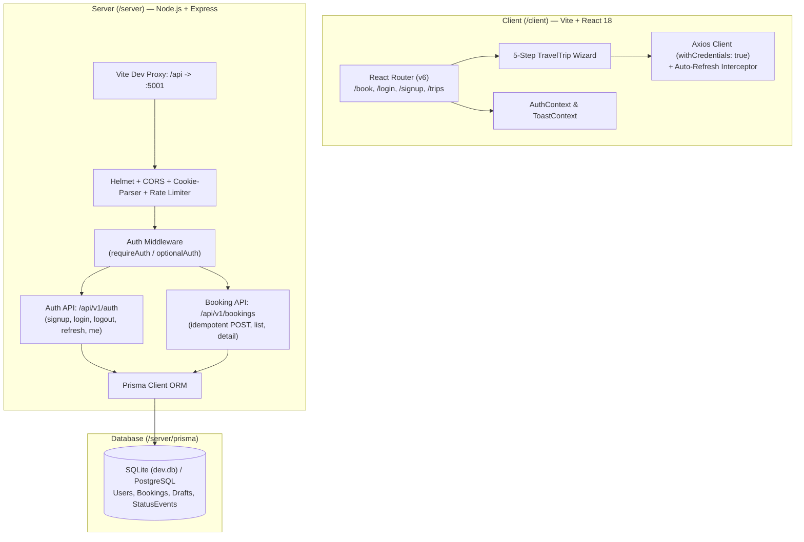

# 🌍 Travel Trip — Full-Stack Trip Booking Application

A production-style travel booking application upgraded from a 5-step front-end wizard into a full-stack, monorepo architecture featuring an Express REST API, Prisma ORM (SQLite / PostgreSQL), JWT authentication with `httpOnly` cookie sessions, idempotent booking submissions, and graceful offline fallback.

---

## 🏗️ Architecture Overview



---

## ✨ Features

### 1. 5-Step Booking Wizard
- **Step 1: Your Details**: Form capturing Name, Start Location, and End Location with instant, simultaneous validation. Automatically pre-fills Name from the authenticated user's profile.
- **Step 2: Date Selection**: Date pickers with validation requiring both dates and enforcing that end date cannot be earlier than start date.
- **Step 3: Guests**: Interactive counter controls for Adults ($\ge 1$), Children ($\ge 0$), and Infants ($\ge 0$) with enforced lower bounds.
- **Step 4: Travel Assistance**: Opt-in assistance checkbox toggling specialized support options (*Wheelchair*, *Medical Support*, *Senior Citizen Support*, *Other*).
- **Step 5: Confirmation**: Full summary card review with **Cancel** (complete reset) and **Confirm** actions.
- **Confirmed Screen**: Real booking reference badge (e.g. `TT-2026-AB12CD`), status badge, success checkmark, and quick actions for *"Book New Trip"*, *"View My Trips"*, and *"Download itinerary (PDF)"*.

### 2. Full-Stack Authentication & Accounts
- Email + password registration and login with **bcryptjs** (salt factor 10).
- Secure session storage:
  - 15-minute JWT access token in `httpOnly`, `SameSite: Lax` cookie.
  - 7-day JWT refresh token in `httpOnly` cookie.
  - Transparent token renewal via Axios response interceptors.
- Rate-limited auth endpoints to prevent credential stuffing or brute-force attacks.

### 3. Database Persistence & Idempotency
- **Prisma ORM** managing relational data:
  - `User`: Accounts and role-based permissions (`USER` / `ADMIN`).
  - `Booking`: Structured trip details, coordinates, guest counts, assistance options, and reference codes.
  - `StatusEvent`: Immutable timeline tracking status changes (`PENDING` $\to$ `CONFIRMED` $\to$ `CANCELLED`).
  - `Draft`: Autosave store for partially completed wizard sessions.
- **Idempotent submissions**: `Idempotency-Key` prevents duplicate booking creation even on double-clicks or unstable connections.

### 4. Graceful Standalone Offline Fallback
- If the backend is unreachable or offline, the wizard falls back to local state management with zero user friction—allowing uninterrupted bookings while offline.

### 5. Routing & Global Toast Feedback
- Declarative client routing via `react-router-dom`:
  - `/` or `/book`: Main Travel Trip wizard.
  - `/login`: User login screen with validation.
  - `/signup`: User registration screen with validation.
  - `/trips`: Dashboard of user bookings.
  - `/admin`: Administrative overview.
- Unobtrusive accessible toast notifications for state changes.

---

## 🛠️ Tech Stack

| Domain | Technologies |
| :--- | :--- |
| **Frontend** | React 18, React Router v6, Vite 6, Plain CSS, Axios, Lucide React |
| **Backend** | Node.js, Express 4, Helmet, CORS, Cookie-Parser, express-rate-limit, Zod |
| **Database & ORM** | Prisma 6, SQLite (zero-config local dev), PostgreSQL ready |
| **Authentication** | JWT (jsonwebtoken), bcryptjs, `httpOnly` cookies |
| **Testing** | Vitest, React Testing Library, Supertest, jsdom |

---

## 📁 Repository Structure

```
.
├── client/                     # Vite + React Frontend
│   ├── src/
│   │   ├── api/                # Axios instance, auth & booking API calls
│   │   ├── components/         # Stepper, Wizard steps, Header, Confirmed
│   │   ├── context/            # AuthContext, ToastContext
│   │   ├── pages/              # Login, Signup, Trips, Admin
│   │   ├── App.js              # Routing & context providers
│   │   ├── App.test.js         # Original 9-test wizard suite (100% passing)
│   │   └── Phase1.test.js      # Auth & API integration tests
│   ├── package.json
│   └── vite.config.js          # JSX in .js enabled + API reverse proxy
│
├── server/                     # Express REST API
│   ├── prisma/
│   │   ├── schema.prisma       # Prisma models: User, Booking, Draft, StatusEvent
│   │   └── dev.db              # SQLite development database (gitignored)
│   ├── src/
│   │   ├── config/             # Runtime environment configuration
│   │   ├── db/                 # Prisma client instance
│   │   ├── middleware/         # Auth verification, rate limiting, error handling
│   │   ├── routes/             # Auth & Booking REST routers
│   │   ├── services/           # Business logic & quote calculations
│   │   ├── validators/         # Zod schemas for input validation
│   │   ├── app.js              # Express app setup
│   │   ├── server.js           # Server bootstrap & graceful shutdown
│   │   └── server.test.js      # Supertest endpoint integration suite
│   ├── .env.example
│   └── package.json
│
├── package.json                # Root npm workspace orchestrator
└── README.md
```

---

## 🚀 Getting Started

### Prerequisites
- **Node.js** (v18.0.0 or later)
- **npm** (v9.0.0 or later)

### 1. Clone the Repository
```bash
git clone https://github.com/sathvikkasanagpttu/travel-trip-app.git
cd travel-trip-app
```

### 2. Install Dependencies
Install all workspace dependencies across `/client` and `/server`:
```bash
npm install
```

### 3. Setup Server Environment
```bash
cp server/.env.example server/.env
```

`server/.env` defaults to:
```env
PORT=5001
NODE_ENV=development
DATABASE_URL="file:./dev.db"
JWT_ACCESS_SECRET="travel-trip-jwt-access-super-secret-key-2026-safe-random-phrase"
JWT_REFRESH_SECRET="travel-trip-jwt-refresh-super-secret-key-2026-safe-random-phrase"
JWT_ACCESS_EXPIRY="15m"
JWT_REFRESH_EXPIRY="7d"
CLIENT_URL="http://localhost:5173"
COOKIE_DOMAIN=""
COOKIE_SECURE="false"
```

### 4. Initialize Database
Generate the Prisma client and push the schema to SQLite:
```bash
npm --prefix server run prisma:generate
npm --prefix server run prisma:push
```

### 5. Run the Application
Open two terminal windows:

**Terminal 1 — Backend API** (`http://localhost:5001`):
```bash
npm run server
```

**Terminal 2 — Frontend App** (`http://localhost:5173`):
```bash
npm run dev
```

Visit [`http://localhost:5173`](http://localhost:5173) in your browser.

---

## 🧪 Testing

The test suite ensures regression-free development and strict compliance with the original specifications:

```bash
# Run all client unit tests (all 9 original tests + 3 auth/persistence tests)
npm test

# Run server integration tests (Supertest + Prisma)
npm --prefix server test
```

### Test Suite Status
- ✅ **12/12 Client Tests Passing**:
  - `renders initial stepper and Your Details page by default`
  - `validates Page 1 (Your Details) and shows all errors simultaneously`
  - `allows completing Page 1 and marks Step 1 completed in Stepper`
  - `validates Page 2 (Date Selection): empty dates and end date < start date`
  - `persists Page 1 values when clicking Previous from Page 2`
  - `handles Page 3 (Guests) defaults, increments, decrements, and lower limits`
  - `handles Page 4 (Travel Assistance) checkbox and dropdown`
  - `displays full summary on Confirmation, resets state on Cancel`
  - `completes the entire flow and renders Confirmed screen, then Book New Trip resets all`
  - `renders Login page with validation`
  - `renders Signup page with validation`
  - `persists booking to API on confirm and displays server reference`
- ✅ **6/6 Server Tests Passing**:
  - `GET /health`
  - `POST /api/v1/auth/signup`
  - `POST /api/v1/auth/login`
  - `GET /api/v1/auth/me`
  - `POST /api/v1/bookings` (with idempotency verification)
  - `GET /api/v1/bookings`

---

## 📡 API Reference

### Health
- `GET /health` — Health check endpoint returning uptime and environment status.

### Authentication (`/api/v1/auth`)
- `POST /signup` — Register a new account (`name`, `email`, `password`). Sets `httpOnly` auth cookies.
- `POST /login` — Authenticate an existing user (`email`, `password`). Sets `httpOnly` auth cookies.
- `POST /logout` — Invalidate session and clear auth cookies.
- `POST /refresh` — Issue a new access token using the refresh cookie.
- `GET /me` — Retrieve the currently authenticated user's profile.

### Bookings (`/api/v1/bookings`)
- `POST /` — Create a new booking (authenticated or guest). Accepts optional `Idempotency-Key` header. Returns booking reference code (`TT-2026-XXXXXX`).
- `GET /` — List bookings for the authenticated user with pagination and status filters.
- `GET /:id` — Retrieve detailed trip information and status event timeline.

---

## 🗺️ Roadmap

- [x] **Phase 1**: Full-stack Monorepo restructuring, Prisma SQLite/PostgreSQL schema, JWT authentication (`httpOnly` cookies), booking persistence, idempotency.
- [ ] **Phase 2**: Draft autosave & resume across reloads, My Trips dashboard, PDF itinerary downloads, automated confirmation email.
- [ ] **Phase 3**: Place autocomplete via OpenStreetMap Nominatim proxy, Leaflet route map preview, live dynamic quote calculation (`/api/quote`), Open-Meteo weather forecast.
- [ ] **Phase 4**: Real-time Socket.IO status updates (`PENDING` $\to$ `CONFIRMED`), admin live feed, multi-tab draft sync.
- [ ] **Phase 5**: Docker compose setup, GitHub Actions CI pipeline, production deployment guides (Vercel + Render/Supabase).

---

## 📄 License

This project is licensed under the [MIT License](LICENSE).
