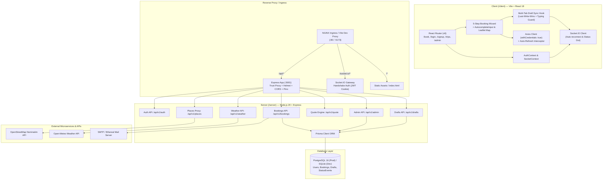

# 🌍 Travel Trip — Full-Stack Real-Time Trip Booking Platform

[](https://github.com/sathvikkasanagpttu/travel-trip-app/actions/workflows/ci.yml)
[](https://nodejs.org/)
[](https://vitejs.dev/)
[](https://docs.docker.com/compose/)
[](https://www.prisma.io/)
[](LICENSE)

A production-ready, full-stack travel booking application built with a modern monorepo architecture. Upgraded from a 5-step React wizard into an enterprise-grade platform featuring an Express REST API, a Socket.IO real-time event gateway, multi-database Prisma ORM (SQLite for local dev & tests, PostgreSQL for production), secure JWT `httpOnly` cookie sessions, OpenStreetMap Nominatim geocoding, Leaflet route mapping, dynamic quote calculation engine, Open-Meteo weather forecasts, PDF itinerary generation, automated email delivery, multi-tab draft sync, and an interactive Admin dashboard.

---

## 🏗️ Architecture Overview



---

## ✨ Features by Phase

### 🚀 Phase 1: Full-Stack Monorepo, Auth & Persistence
- **Monorepo Architecture**: Clean separation into `/client` and `/server` workspaces managed by root npm.
- **Relational Models (Prisma ORM)**:
  - `User`: Roles (`USER`, `ADMIN`), bcrypt-hashed passwords.
  - `Booking`: Route coordinates, dates, guest breakdown, assistance options, unique human reference (`TT-2026-XXXXXX`), and status (`PENDING`, `CONFIRMED`, `CANCELLED`).
  - `StatusEvent`: Immutable timeline tracking status history.
  - `Draft`: Per-user autosave storage.
- **Secure JWT Authentication**:
  - 15-minute access token + 7-day refresh token in `httpOnly`, `SameSite: Lax/None` cookies.
  - Automatic token refresh interceptors.
  - Brute-force rate limiting on auth endpoints.
- **Idempotency**: Enforced `Idempotency-Key` header prevents duplicate submissions.
- **Graceful Offline Fallback**: Wizard functions locally with simulated confirmation if the server is unreachable.

### 📋 Phase 2: Draft Autosave, My Trips Dashboard, PDF & Email
- **Draft Autosave & Resume**:
  - Debounced (800ms) background saving to DB (or `localStorage` for guests).
  - *"Resume your draft trip?"* prompt on `/book` with **Resume** and **Start fresh**.
- **My Trips Dashboard (`/trips`)**:
  - Tabs: **Upcoming**, **Past**, and **Cancelled** with search and pagination.
- **Trip Detail (`/trips/:id`)**:
  - Full trip overview, traveler details, live status badge, and audit timeline.
  - Safe cancellation modal with future-date validation.
- **PDF Itinerary Downloads**: Branded PDF itinerary generated dynamically via **PDFKit**.
- **Email Notifications**: Non-blocking HTML email dispatch via **Nodemailer** for confirmations and cancellations.

### 🗺️ Phase 3: Places Autocomplete, Route Map, Quote Engine & Weather
- **OpenStreetMap Nominatim Proxy**:
  - Rate-limited (1 req/sec) and in-memory cached (10 mins) geocoding proxy.
  - Accessible `AutocompleteInput` with keyboard navigation (Up, Down, Enter, Esc).
- **Interactive Leaflet Route Map**:
  - Interactive map preview with departure and arrival markers, polyline route, and Haversine distance in km.
- **Dynamic Pricing Quote Engine (`POST /api/v1/quote`)**:
  - Live price estimation calculating route distance, nights, guest multipliers (Adults 100%, Children 50%, Infants 0%), and assistance surcharges.
  - Server re-computes and verifies final total on booking creation.
- **Open-Meteo Weather Forecast (`GET /api/v1/weather`)**:
  - 16-day daily meteorological forecast for destination coordinates with WMO weather codes and precipitation probabilities.

### ⚡ Phase 4: Socket.IO Real-Time Gateway & Admin Dashboard
- **WebSocket Handshake Auth**: Authenticates connections using `httpOnly` JWT cookies.
- **Isolated Rooms**: `user:<userId>`, `booking:<bookingId>`, and `admins`.
- **Live Connection Status**: Status dot in Header indicating **Connected** (pulsing green), **Reconnecting** (pulsing orange), or **Offline** (gray).
- **Live Status Animations**: `useBookingStatus(bookingId)` hook animating status badges (`PENDING` $\to$ `CONFIRMED`) with toasts.
- **Multi-Tab Draft Sync**: Real-time cross-tab synchronization with last-write-wins and typing guards.
- **Live Rate Banner**: Confirmation step receives price update alerts and requires re-acknowledgment before submission.
- **Admin Dashboard (`/admin`)**:
  - Live sliding row feed for incoming bookings.
  - Counters (Total, Pending, Confirmed, Cancelled).
  - Recharts daily bookings frequency chart.
  - Quick action buttons (Confirm / Reject) and CSV export.
- **Auto-Confirm Simulation**: Optional configurable delay (`AUTO_CONFIRM_SECONDS`) to auto-promote bookings for live demonstrations.

### 🐳 Phase 5: Containerization, CI/CD & Production Hardening
- **Multi-Stage Dockerfiles**:
  - `/server/Dockerfile`: Node 20 Alpine, non-root user `nodejs`, automated migration deployment, healthcheck.
  - `/client/Dockerfile`: Node 20 Alpine builder + NGINX Alpine runner with SPA fallback and reverse proxy.
- **Docker Compose**: Orchestrates PostgreSQL 16 with healthcheck, backend server, and frontend client. Includes `dev` profile with volume mounts for live reload.
- **Production Hardening**:
  - Dynamic Prisma provider switching (`prepare-prisma.js` switches between SQLite and PostgreSQL).
  - Reverse proxy trust (`app.set('trust proxy', 1)`).
  - Cross-domain cookie security (`SameSite=None`, `Secure=true`).
  - Graceful process termination (`SIGTERM`, `SIGINT`).
  - Database-aware healthcheck (`GET /health`).
- **GitHub Actions CI/CD Pipeline**:
  - Automated tests on Node 20, client build, and Docker smoke build tests.
  - Deploy workflow with Render and Vercel webhooks.

---

## 🖼️ Application Screenshots

| Booking Wizard — Your Details | Route Map & Weather Forecast |
| :---: | :---: |
|  |  |

| My Trips Dashboard | Real-Time Admin Dashboard |
| :---: | :---: |
|  |  |

---

## 🛠️ Tech Stack

| Domain | Technologies |
| :--- | :--- |
| **Frontend** | React 18, React Router v6, Vite 6, Plain CSS, Socket.IO Client, Leaflet, React-Leaflet, Recharts, Axios, Lucide React |
| **Backend** | Node.js 20, Express 4, Socket.IO, Helmet, CORS, Cookie-Parser, express-rate-limit, Pino, Pino-HTTP, Zod, PDFKit, Nodemailer |
| **Database & ORM** | Prisma 6, SQLite (dev/test), PostgreSQL 16 (production) |
| **Containers & Web**| Docker, Docker Compose, NGINX Alpine |
| **CI / CD** | GitHub Actions (CI & CD workflows) |
| **Hosting Targets** | Vercel (Frontend), Render (Backend), Supabase / Neon (Database) |

---

## 📜 NPM Scripts Reference

### Root Workspace Scripts
| Script | Command | Purpose |
| :--- | :--- | :--- |
| `npm run dev` | `concurrently ...` | Runs client (port 5173) and server (port 5001) concurrently |
| `npm test` | `npm test --workspaces` | Runs both client (31 tests) and server (37 tests) suites |
| `npm run build` | `npm run build --workspace=client` | Builds production frontend assets to `/client/dist` |
| `npm run client` | `npm run dev --workspace=client` | Runs frontend Vite dev server only |
| `npm run server` | `npm run dev --workspace=server` | Runs backend Express server only |

### Server Scripts (`/server`)
| Script | Command | Purpose |
| :--- | :--- | :--- |
| `npm run dev` | `node --watch src/server.js` | Starts server with Node native file watching |
| `npm run prisma:generate` | `node scripts/prepare-prisma.js && prisma generate` | Prepares schema and generates client |
| `npm run prisma:deploy` | `node scripts/prepare-prisma.js && prisma migrate deploy` | Applies migrations in production |
| `npm run prisma:push` | `node scripts/prepare-prisma.js && prisma db push` | Pushes schema directly to DB |
| `npm run prisma:seed` | `node prisma/seed.js` | Seeds default Admin and User accounts |

---

## ⚙️ Environment Variables Table

### Server (`server/.env`)
| Variable | Default Value | Description |
| :--- | :--- | :--- |
| `PORT` | `5001` | Express HTTP & WebSocket listening port |
| `NODE_ENV` | `development` | Application runtime environment (`development` / `production`) |
| `DATABASE_URL` | `file:./dev.db` | SQLite file path or PostgreSQL connection string |
| `DIRECT_URL` | *(optional)* | Direct unpooled connection URL for Prisma migrations on Neon/Supabase |
| `CLIENT_URL` | `http://localhost:5173` | Allowed frontend origin for CORS and cookies |
| `JWT_ACCESS_SECRET` | *(string)* | Secret key for signing 15-minute access JWTs |
| `JWT_REFRESH_SECRET`| *(string)* | Secret key for signing 7-day refresh JWTs |
| `COOKIE_SECURE` | `false` | Set to `true` in HTTPS production |
| `COOKIE_SAME_SITE` | `lax` | Set to `none` when frontend and backend are on different domains |
| `NOMINATIM_USER_AGENT` | *(string)* | Custom User-Agent header for OpenStreetMap Nominatim proxy |
| `QUOTE_RATE_PER_KM` | `5` | Quote engine per-kilometer rate in ₹ |
| `QUOTE_NIGHT_RATE` | `1000` | Quote engine per-night rate in ₹ |
| `QUOTE_ASSISTANCE_SURCHARGE` | `500` | Flat travel assistance surcharge in ₹ |
| `AUTO_CONFIRM_SECONDS` | `0` | Delay in seconds to auto-confirm bookings (0 = disabled) |
| `SMTP_HOST` | *(empty)* | SMTP server host (e.g. `smtp.ethereal.email` or SendGrid) |
| `SMTP_PORT` | `587` | SMTP server port |
| `SMTP_USER` | *(empty)* | SMTP authentication username |
| `SMTP_PASS` | *(empty)* | SMTP authentication password |
| `MAIL_FROM` | `no-reply@traveltrip.com`| Default email sender address |

### Client (`client/.env`)
| Variable | Default Value | Description |
| :--- | :--- | :--- |
| `VITE_API_URL` | `/api/v1` | Base REST API URL (`https://your-api.onrender.com/api/v1` in prod) |
| `VITE_SOCKET_URL` | `http://localhost:5001` | Socket.IO gateway URL (`https://your-api.onrender.com` in prod) |

---

## 🚀 Quickstart & Local Setup

### 1. Clone & Install
```bash
git clone https://github.com/sathvikkasanagpttu/travel-trip-app.git
cd travel-trip-app
npm install
```

### 2. Setup Local Environment
```bash
cp server/.env.example server/.env
cp client/.env.example client/.env
```

### 3. Initialize & Seed Database
```bash
npm --prefix server run prisma:generate
npm --prefix server run prisma:push
npm --prefix server run prisma:seed
```

### 4. Run Locally
```bash
npm run dev
```
- Client runs at: [`http://localhost:5173`](http://localhost:5173)
- Server API runs at: [`http://localhost:5001`](http://localhost:5001)

#### Default Demo Credentials:
| Account | Email | Password | Role |
| :--- | :--- | :--- | :--- |
| **Admin** | `admin@traveltrip.com` | `Admin@123456` | `ADMIN` (Access to `/admin` dashboard) |
| **User** | `user@traveltrip.com` | `User@123456` | `USER` (Standard booking customer) |

---

## 🐳 Docker Deployment

### Run Complete Stack with Docker Compose
To build and spin up the PostgreSQL 16 database, backend server, and NGINX frontend client in production containers:
```bash
# Build and run all services
docker compose up --build

# Run in detached background mode
docker compose up -d --build

# View logs
docker compose logs -f

# Stop all services
docker compose down -v
```

Once running:
- **Frontend App**: [`http://localhost:3000`](http://localhost:3000) (served via NGINX with reverse proxy to `/api` and `/socket.io`)
- **Backend API**: [`http://localhost:5001`](http://localhost:5001)
- **PostgreSQL Database**: `localhost:5432` (`postgres` / `postgres`)

### Development with Live Reload in Docker
```bash
docker compose --profile dev up
```

---

## 📡 API Reference Summary

### REST Endpoints
| Category | Method | Endpoint | Description | Auth Required |
| :--- | :--- | :--- | :--- | :--- |
| **System** | `GET` | `/health` | Health check endpoint returning database connectivity, uptime, and env | No |
| **Auth** | `POST` | `/api/v1/auth/signup` | Register new account (`name`, `email`, `password`) and sets cookies | No |
| **Auth** | `POST` | `/api/v1/auth/login` | Authenticate user (`email`, `password`) and issue httpOnly cookies | No |
| **Auth** | `POST` | `/api/v1/auth/logout` | Invalidate session and clear auth cookies | Yes |
| **Auth** | `POST` | `/api/v1/auth/refresh` | Issue new access token using refresh cookie | Yes |
| **Auth** | `GET` | `/api/v1/auth/me` | Fetch currently authenticated user's profile | Yes |
| **Bookings**| `POST` | `/api/v1/bookings` | Create booking (requires `Idempotency-Key` header) | Yes |
| **Bookings**| `GET` | `/api/v1/bookings` | List user's bookings with pagination and tab filter (`upcoming`, `past`, `cancelled`) | Yes |
| **Bookings**| `GET` | `/api/v1/bookings/:id` | Fetch booking detail and status timeline | Yes |
| **Bookings**| `POST` | `/api/v1/bookings/:id/cancel` | Cancel future booking owned by the user | Yes |
| **Bookings**| `GET` | `/api/v1/bookings/:id/itinerary.pdf` | Download generated PDF itinerary attachment | Yes |
| **Drafts** | `GET` | `/api/v1/drafts/me` | Retrieve saved booking wizard draft | Yes |
| **Drafts** | `PUT` | `/api/v1/drafts/me` | Save or update booking wizard draft | Yes |
| **Drafts** | `DELETE` | `/api/v1/drafts/me` | Delete saved draft | Yes |
| **Places** | `GET` | `/api/v1/places/search?q=` | Geocoding autocomplete proxy to Nominatim (cached, rate-limited) | No |
| **Quote** | `POST` | `/api/v1/quote` | Dynamic quote calculation with distance, nights, and guests | No |
| **Weather** | `GET` | `/api/v1/weather?lat=&lng=&start=&end=` | Open-Meteo 16-day daily forecast proxy | No |
| **Admin** | `GET` | `/api/v1/admin/bookings` | Search and filter all bookings with counters | Admin |
| **Admin** | `PATCH` | `/api/v1/admin/bookings/:id/status` | Update booking status (`CONFIRMED`/`CANCELLED`) with audit note | Admin |
| **Admin** | `POST` | `/api/v1/admin/quote-rates` | Update quote engine rates and broadcast `quote:updated` | Admin |

### Socket.IO Real-Time Events
| Event Name | Direction | Payload | Description |
| :--- | :--- | :--- | :--- |
| `join:booking` | Client $\to$ Server | `bookingId` | Join room `booking:<bookingId>` (owner or admin only) |
| `leave:booking` | Client $\to$ Server | `bookingId` | Leave room `booking:<bookingId>` |
| `draft:update` | Client $\to$ Server | `{ stepId, payload, updatedAt }` | Sync draft across user's active browser tabs |
| `draft:synced` | Server $\to$ Client | `{ stepId, payload, updatedAt, sourceSocketId }` | Broadcast draft updates to user's other open sockets |
| `booking:status` | Server $\to$ Client | `{ bookingId, status, note, at }` | Broadcast status updates to booking room, user room, and admins |
| `admin:new-booking` | Server $\to$ Client | `{ bookingSummary, at }` | Broadcast newly created booking to the `admins` room |
| `quote:updated` | Server $\to$ Client | `{ target, newTotal, oldTotal, at }` | Broadcast pricing rate changes to all connected clients |

---

## ☁️ Cloud Deployment Guides

### Step 1: Managed Database (Supabase or Neon PostgreSQL)
1. Sign in to [Supabase](https://supabase.com) or [Neon](https://neon.tech) and create a new PostgreSQL project.
2. Under **Project Settings $\to$ Database**, obtain:
   - **Pooled Connection String** (Transaction pooler / port 6543): Use this as `DATABASE_URL`.
   - **Direct Connection String** (Session mode / port 5432): Use this as `DIRECT_URL`.
3. Set these environment variables in your server hosting environment.

### Step 2: Backend API on Render
1. Create a new **Web Service** on [Render](https://render.com) connected to your repository.
2. Configure settings:
   - **Root Directory**: `server`
   - **Environment**: `Node`
   - **Build Command**: `npm ci && npx prisma generate && npx prisma migrate deploy`
   - **Start Command**: `node src/server.js`
   - **Instance Type**: Paid / Starter recommended (Render free tier instances sleep after inactivity, which disconnects WebSockets).
3. Set Environment Variables:
   - `NODE_ENV`: `production`
   - `DATABASE_URL`: *Your pooled PostgreSQL connection string*
   - `DIRECT_URL`: *Your direct PostgreSQL connection string*
   - `CLIENT_URL`: `https://your-travel-trip.vercel.app`
   - `JWT_ACCESS_SECRET`: *Random 32-character string*
   - `JWT_REFRESH_SECRET`: *Random 32-character string*
   - `COOKIE_SECURE`: `true`
   - `COOKIE_SAME_SITE`: `none`
   - `NOMINATIM_USER_AGENT`: `TravelTripApp/1.0 (admin@yourdomain.com)`

### Step 3: Frontend Client on Vercel
1. Create a new project on [Vercel](https://vercel.com) and import the repository.
2. Configure settings:
   - **Root Directory**: `client`
   - **Framework Preset**: `Vite`
   - **Build Command**: `vite build`
   - **Output Directory**: `dist`
3. Set Environment Variables:
   - `VITE_API_URL`: `https://your-api.onrender.com/api/v1`
   - `VITE_SOCKET_URL`: `https://your-api.onrender.com`
4. The included [`client/vercel.json`](file:///Users/kasanagotttusathvik/Downloads/Travel%20Trip/client/vercel.json) ensures all SPA client-side routes rewrite to `/index.html`.

---

## 📋 Post-Deployment Verification Checklist

- [ ] **Account Creation**: Register a new user at `/signup` and verify redirection to the booking wizard.
- [ ] **Cross-Domain Cookies**: Inspect developer tools Application $\to$ Cookies tab; verify `accessToken` and `refreshToken` are set with `SameSite=None` and `Secure=true`.
- [ ] **Place Autocomplete**: Type `Hyd` into Start Location; verify dropdown displays suggestions and coordinates populate.
- [ ] **Route Map & Quote**: Verify route polyline renders on Leaflet map and price breakdown updates dynamically.
- [ ] **Booking Confirmation**: Confirm booking; verify unique reference is returned (`TT-2026-XXXXXX`) and draft is deleted.
- [ ] **PDF Download**: Click *"Download itinerary (PDF)"* and verify downloaded document formatting.
- [ ] **Email Dispatch**: Verify confirmation email is delivered via SMTP.
- [ ] **Real-Time WebSocket**: Check Header connection dot is green (`connected`); open `/admin` as admin in a second window and verify live booking feed updates instantly.

---

## 🔧 Production Troubleshooting

| Issue | Cause | Solution |
| :--- | :--- | :--- |
| **Cookies not set across domains** | Browser blocks cross-origin cookies without HTTPS or correct flags. | Ensure backend sets `COOKIE_SAME_SITE="none"` and `COOKIE_SECURE="true"`, and `app.set('trust proxy', 1)` is enabled. |
| **CORS errors in browser console** | Deployed frontend domain missing from backend allowlist. | Update `CLIENT_URL` in backend env to match the exact Vercel URL (e.g. `https://travel-trip.vercel.app` without trailing slash). |
| **Prisma migrate fails on cloud DB** | Transaction pooler does not allow DDL schema migrations. | Set `DIRECT_URL` pointing to the direct database connection (port 5432) alongside `DATABASE_URL`. |
| **WebSocket falling back to polling** | Hosting provider proxy does not support persistent connections or free tier is asleep. | Use paid always-on tier on Render, and verify client `VITE_SOCKET_URL` uses `https://` with credentials. |
| **Vite JSX in `.js` error on build** | Esbuild loader not configured for `.js` JSX files. | Retained in `client/vite.config.js`: `loader: 'jsx', include: /src\/.*\.jsx?$/`. |

---

## 🧪 Automated Testing

The platform features **68 automated tests** (31 frontend + 37 backend) providing comprehensive test coverage:

```bash
# Run all tests across the monorepo
npm test

# Client tests (Vitest + React Testing Library)
npm test --prefix client

# Server integration tests (Vitest + Supertest + Socket.IO)
npm test --prefix server
```

---

## 📁 Final Repository Tree

```
travel-trip-app/
├── .github/
│   └── workflows/
│       ├── ci.yml                 # CI Pipeline (Test, Lint, Build, Docker Smoke)
│       └── deploy.yml             # CD Webhook Dispatch (Render & Vercel)
├── client/
│   ├── public/
│   ├── src/
│   │   ├── api/                   # API clients (admin, auth, bookings, drafts, places, quote, weather)
│   │   ├── components/
│   │   │   ├── AutocompleteInput/ # Accessible Nominatim combobox
│   │   │   ├── Confirmation/      # Step 5 summary + price updated banner
│   │   │   ├── Confirmed/         # Success screen + live status badge + PDF
│   │   │   ├── DateSelection/     # Step 2 date picker
│   │   │   ├── Guests/            # Step 3 counters
│   │   │   ├── Header/            # Navigation + live socket status dot
│   │   │   ├── PriceBreakdown/    # Live quote breakdown card
│   │   │   ├── ProtectedRoute/    # Role-based route guard
│   │   │   ├── RouteMap/          # Leaflet interactive route preview
│   │   │   ├── Stepper/           # Progress stepper
│   │   │   ├── TravelAssistance/  # Step 4 assistance checkboxes
│   │   │   ├── TravelTrip/        # Wizard coordinator & draft manager
│   │   │   ├── WeatherStrip/      # Open-Meteo 16-day forecast bar
│   │   │   └── YourDetails/       # Step 1 input fields
│   │   ├── context/
│   │   │   ├── AuthContext.js     # User session state
│   │   │   └── SocketContext.js   # Real-time WebSocket connection
│   │   ├── hooks/
│   │   │   ├── useBookingStatus.js# Real-time booking room subscriber
│   │   │   ├── useDraftAutosave.js# Multi-tab draft sync + autosave
│   │   │   ├── useQuote.js        # Debounced pricing calculator
│   │   │   └── useWeather.js      # Weather forecast fetcher
│   │   ├── pages/
│   │   │   ├── Admin/             # Admin live feed table + Recharts
│   │   │   ├── Login/             # Customer sign-in
│   │   │   ├── Signup/            # Registration
│   │   │   ├── TripDetail/        # Single trip timeline & cancellation
│   │   │   └── Trips/             # My Trips dashboard (tabs + search)
│   │   ├── utils/
│   │   │   └── geo.js             # Client haversine calculations
│   │   ├── App.js                 # App routes & provider wraps
│   │   ├── App.test.js            # Base 9-test wizard suite
│   │   ├── Phase1.test.js         # Auth & persistence tests
│   │   ├── Phase2.test.js         # Drafts, trips, and PDF tests
│   │   ├── Phase3.test.js         # Autocomplete & map tests
│   │   ├── Phase4.test.js         # Real-time socket & admin tests
│   │   ├── index.css
│   │   ├── main.js
│   │   └── setupTests.js          # Leaflet & Recharts JSDOM mocks
│   ├── .dockerignore
│   ├── .env.example
│   ├── Dockerfile                 # Multi-stage Vite + NGINX
│   ├── nginx.conf                 # NGINX reverse proxy & SPA fallback
│   ├── package.json
│   ├── vercel.json                # Vercel SPA rewrites
│   └── vite.config.js             # JSX in .js loader & dev proxy
├── server/
│   ├── prisma/
│   │   ├── migrations/            # PostgreSQL migrations
│   │   │   └── 20260101000000_init/
│   │   │       └── migration.sql
│   │   ├── dev.db                 # SQLite local database (gitignored)
│   │   ├── schema.prisma          # Relational models
│   │   └── seed.js                # Default Admin & User seeds
│   ├── scripts/
│   │   ├── docker-entrypoint.sh   # Container migration & startup script
│   │   └── prepare-prisma.js      # Dynamic SQLite/PostgreSQL provider switch
│   ├── src/
│   │   ├── config/
│   │   │   └── env.js             # Validated runtime environment
│   │   ├── db/
│   │   │   └── prisma.js          # Prisma singleton
│   │   ├── middleware/
│   │   │   ├── auth.js            # requireAuth & requireAdmin guards
│   │   │   ├── errorHandler.js    # Standard error format
│   │   │   └── rateLimiter.js     # Rate limiting middlewares
│   │   ├── routes/
│   │   │   ├── admin.routes.js    # Admin feed, status patch, quote rates
│   │   │   ├── auth.routes.js     # Signup, login, logout, refresh, me
│   │   │   ├── bookings.routes.js # Create, list, detail, cancel, PDF
│   │   │   ├── drafts.routes.js   # User draft endpoints
│   │   │   ├── places.routes.js   # Nominatim geocoding proxy
│   │   │   ├── quote.routes.js    # Dynamic pricing calculations
│   │   │   └── weather.routes.js  # Open-Meteo forecast proxy
│   │   ├── services/
│   │   │   ├── auth.service.js    # JWT & cookie operations
│   │   │   ├── booking.service.js # Booking lifecycle & status emissions
│   │   │   ├── draft.service.js   # Draft DB operations
│   │   │   ├── email.service.js   # Nodemailer dispatch
│   │   │   ├── pdf.service.js     # PDFKit document generator
│   │   │   └── quote.service.js   # Haversine & pricing logic
│   │   ├── utils/
│   │   │   ├── geo.js             # Server haversine distance
│   │   │   └── logger.js          # Pino logger instance
│   │   ├── validators/
│   │   │   ├── auth.schema.js     # Zod auth validators
│   │   │   └── booking.schema.js  # Zod booking validators
│   │   ├── app.js                 # Express configuration & routes
│   │   ├── server.js              # Server entrypoint & graceful shutdown
│   │   ├── server.test.js         # 37 integration tests
│   │   └── socket.js              # Socket.IO gateway & rooms
│   ├── .dockerignore
│   ├── .env.example
│   ├── Dockerfile                 # Multi-stage Node 20 Alpine (non-root)
│   └── package.json
├── .dockerignore                  # Root dockerignore
├── .gitignore
├── docker-compose.yml             # PostgreSQL 16 + Server + Client stack
├── package-lock.json
├── package.json                   # Root monorepo workspace
└── README.md
```

---

## 📄 License

This project is licensed under the [MIT License](LICENSE).
